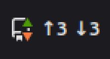
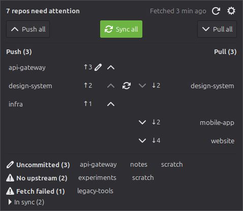

# repotray

A tray indicator that watches all the git clones on your machine and shows, at a glance, how many
have **local work** (uncommitted changes or commits to push) and how many have **remote work**
(commits to pull). Hover to see which repositories; click to get a panel with one-click
**Push**, **Pull** and **Sync** buttons. Built for Linux Mint Cinnamon, where it looks like every
other tray icon, with a platform-independent core that other desktops and operating systems plug
into.





*Screenshots use `repotray tray --demo` (fabricated repositories).*

## Features

- **Counts at a glance.** The label next to the icon shows `↑3 ↓1` (repos to push / to pull).
  A green ▲ in the top-right corner means something to push, an orange ▼ in the bottom-right
  corner (the spot and colour of Mint's "updates available") means something to pull. Prefer
  Mint-style dots? Set `marker = "dot"`.
- **Native look on Cinnamon.** The icon is a monochrome *symbolic* SVG that the panel recolours
  like its neighbours; dots use the theme's success/warning colours.
- **Panel.** Left click opens a popup with one row per repository: its push button on the left,
  its pull button on the right, a *Sync* button in the middle when the branch diverged.
  *Push all*, *Sync all* and *Pull all* at the top; groups for uncommitted, no-upstream, detached
  and failed repos below.
- **Safe by design.** Never `--force`, never prompts for credentials, aborts a conflicting rebase
  so the repository is left exactly as it was, and status checks never write to your repos.
- **Headless CLI.** `repotray status`, `scan`, `fetch`, `push`, `pull`, `sync` work without a GUI.
- **Portable.** Backends for XApp (Cinnamon, MATE, Xfce), AppIndicator (KDE, GNOME with the
  extension), Gtk.StatusIcon (X11) and pystray (macOS, Windows — experimental). New backends can
  live in separate packages.

## Install

**Linux Mint / Cinnamon (recommended).** No pip needed; Python ≥ 3.11 and the system PyGObject:

```sh
git clone https://github.com/ymihere/repotray
cd repotray
scripts/install.sh              # add --autostart to start it at login
```

This copies repotray to `~/.local/share/repotray`, puts a `repotray` launcher in `~/.local/bin`,
installs the icons into your user icon theme, adds a menu entry and starts the tray.
`scripts/uninstall.sh` removes all of it (your config stays unless you pass `--purge`).

**Other Linux desktops.** The same, plus the AppIndicator typelib if your desktop has no XApp
status applet: `sudo apt install gir1.2-ayatanaappindicator3-0.1` (Debian/Ubuntu).

**pipx** (once published on PyPI): `pipx install --system-site-packages repotray`
(`--system-site-packages` lets it see the system's PyGObject).

**macOS / Windows** (experimental, untested by the maintainer): `pip install repotray`, then run
`repotray`. You get the icon, tooltip and a menu with the same actions; the panel is Linux-only
for now.

## Usage

| Action | Effect |
|---|---|
| Hover | Tooltip listing what to push and pull |
| Left click | Toggle the panel |
| Middle click | Fetch all now |
| Right click | Control menu: Fetch all now, Pause fetching, Rescan roots, Open config file, Autostart, About, Quit |

In the panel, each repository row has a button: **Push** (`git push` to its upstream), **Pull**
(`git pull --ff-only`) or, for a branch that has diverged, **Sync** (`git pull --rebase`, then
`git push`; `sync_strategy = "merge"` merges instead). Sync refuses to run while the repository
has uncommitted tracked changes, and if the rebase hits conflicts it is aborted and the repository
is left as it was. **Push all** pushes every repository that is only ahead, **Pull all** pulls
every one that is only behind, and **Sync all** does both and also syncs the diverged ones. Rows
are sorted by name; `panel_sort = "state"` puts syncable, then pushable, then pullable first. Click a repository name for
*Open terminal here*, *Open folder*, *Copy path* and *Fetch now*.

repotray fetches every 10 minutes (and after resume from suspend), checks local status every
minute, and backs off when the network is down.

## Configuration

The config file is created on first run at `~/.config/repotray/config.toml` and reloaded
automatically when you save it. The most useful keys:

```toml
roots = ["~/code", "~/work"]      # where to look for clones (default: your home)
ignore = ["~/work/archive/*"]
fetch_interval = 600
sync_strategy = "rebase"          # or "merge"

panel_sort = "name"               # or "state": syncable, pushable, pullable first

[indicator]
label = ["push", "pull"]          # add "dirty" for ✎N
marker = "arrow"                  # ▲ push / ▼ pull; "dot" for Mint-style dots
top_dot = ["push"]
bottom_dot = ["pull"]
```

Every key, with recipes for the icon, is in [docs/configuration.md](docs/configuration.md).

## Command line

```
repotray [tray] [--demo]           start the tray (default)
repotray status [--json] [--demo]  one status pass, print a table or JSON
repotray scan [--absolute]         list discovered repositories
repotray fetch [REPO...]           fetch, then print status
repotray push [--all | REPO...]    git push to the upstream; --all = Push all
repotray pull [--all | REPO...]    git pull --ff-only; --all = Pull all
repotray sync [--all | REPO...]    push, pull or rebase+push as each repo needs
repotray doctor                    environment, config, backends and icons report
repotray config path|default
repotray autostart enable|disable|status
repotray icons install|uninstall
repotray quit
```

Details, exit codes and the JSON schema: [docs/cli.md](docs/cli.md).

## Safety guarantees

- repotray modifies a repository only when you press Push, Pull, Sync or Sync all (or run the
  matching CLI command). Fetching only updates remote-tracking refs.
- Never `--force`, never `-u`, never auto-stash.
- git runs with an environment that cannot prompt (`GIT_TERMINAL_PROMPT=0`, `BatchMode` ssh,
  no askpass), so a remote needing credentials fails fast with a message instead of hanging.
- A failed or timed-out sync aborts its rebase or merge; the result says whether the repository
  was restored (the tests prove it is).
- Status checks run with `GIT_OPTIONAL_LOCKS=0` and never write the index.

## Platform support

| Platform | Backend | Status |
|---|---|---|
| Linux Mint 22 Cinnamon (X11) | xapp | **Tested** — icon, label, tooltip, panel, menus |
| Cinnamon via AppIndicator / Gtk.StatusIcon | appindicator, gtkstatusicon | Tested to display |
| MATE, Xfce with the XApp applet | xapp | Expected to work |
| KDE Plasma, GNOME + AppIndicator extension | appindicator | Expected to work (no tooltip) |
| Wayland sessions | appindicator | Expected to work; panel opens at the pointer |
| macOS, Windows | pystray | Experimental, untested — help wanted |

Ports are welcome: see [docs/porting.md](docs/porting.md).

## Contributing

See [CONTRIBUTING.md](CONTRIBUTING.md). Design: [SPEC.md](SPEC.md) (behaviour) and
[PLAN.md](PLAN.md) (structure); [docs/architecture.md](docs/architecture.md) for an overview;
[docs/troubleshooting.md](docs/troubleshooting.md) when something does not work.

## Credits

The tray icon is the [Octicons](https://github.com/primer/octicons) `repo` glyph, MIT licence,
© GitHub Inc. (see `src/repotray/icons/data/LICENSE-octicons`). It is not the GitHub logo.

## Licence

MIT — see [LICENSE](LICENSE).
